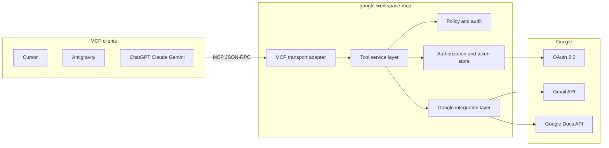
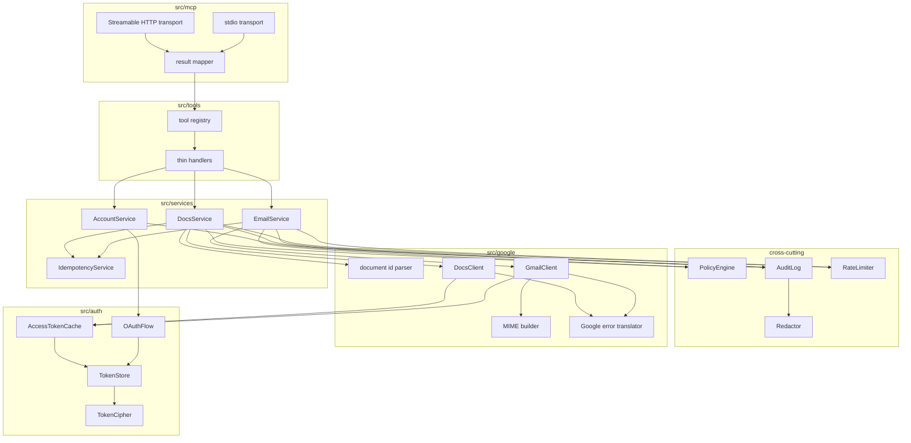
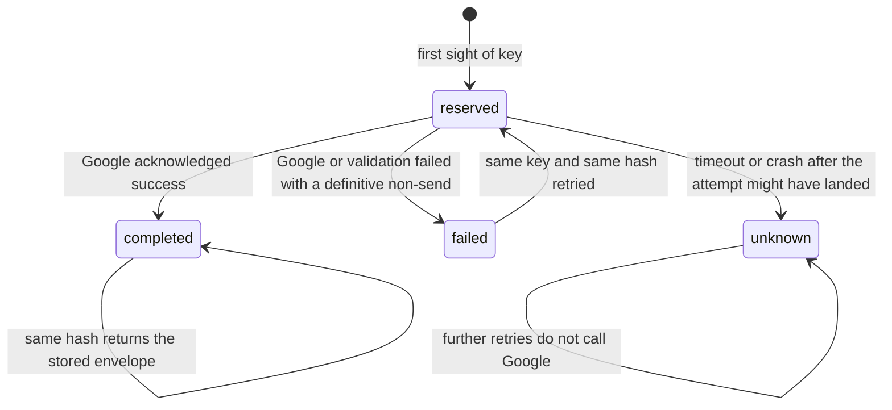
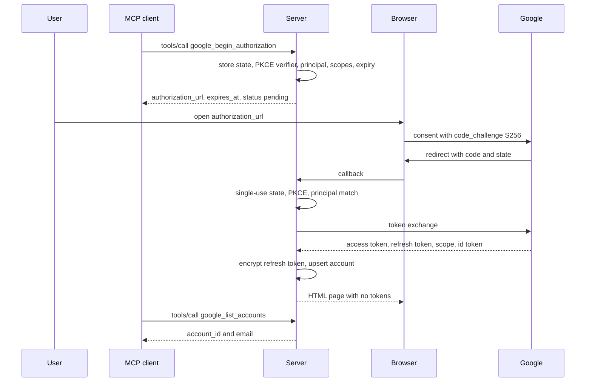
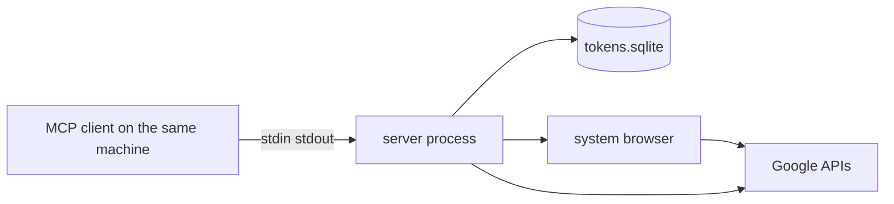
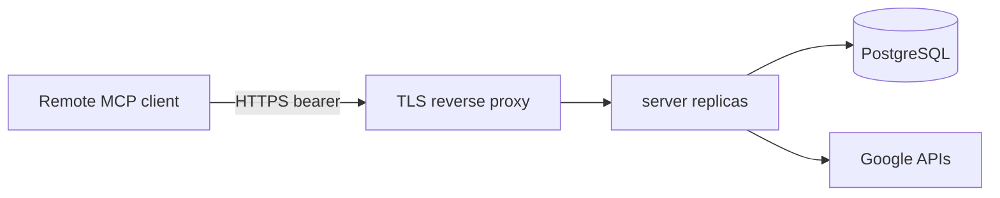

# Architecture: Gmail and Google Docs MCP Server

| | |
|---|---|
| Status | Proposed architecture for v1 |
| Source | [problemStatement.md](./problemStatement.md) |
| Protocol target | [MCP specification 2026-07-28](https://modelcontextprotocol.io/specification/2026-07-28) |
| Date | 2026-10-10 |

This document is the implementation contract for a standards-based Model Context Protocol server that sends Gmail and appends to existing Google Docs. Tool semantics are identical on every transport. An agent discovers the tools, calls them with JSON arguments, and receives a structured result. The server holds Google credentials and performs the side effect only when a tool is invoked.

## 1. Purpose and boundaries

### 1.1 What this server is

A single process that:

1. Speaks MCP over stdio, and over Streamable HTTP when deployed as a service.
2. Exposes a small, stable tool set for Gmail send, Google Docs append, and Google account authorization.
3. Calls Google APIs with OAuth 2.0 tokens that never appear in tool arguments, tool results, prompts, or logs.
4. Validates every write, records an audit event, and deduplicates retries when the caller supplies an idempotency key.

Any MCP client can use it. Cursor, Antigravity, ChatGPT, Claude, Gemini, and later agents all see the same tool names, JSON Schemas, and result envelopes. The server has no client-specific prompt, wrapper, or authentication convention beyond MCP itself.

### 1.2 v1 capabilities

| Tool | Effect |
|---|---|
| `gmail_send_email` | Submit one MIME message through the Gmail API for an authorized account |
| `gdocs_append_content` | Insert plain text at the end of an existing Google Doc |
| `google_list_accounts` | List the caller's authorized accounts and non-sensitive display metadata |
| `google_authorization_status` | Report whether an account holds the scopes a capability needs |
| `google_begin_authorization` | Start a Google OAuth flow and return an authorization URL |

### 1.3 Out of scope for v1

The server is an integration, not a product surface for mail or documents.

- Inbox read, search, labels, campaigns, and mailbox management stay out. The Gmail scope is send-only, so the server cannot read mail even if a caller asks.
- Creating, deleting, sharing, renaming, or reformatting Google Docs stays out. v1 only appends plain text.
- The server does not replace the MCP client's confirmation UI. A tool call is the execution boundary. Clients show a preview and obtain user consent before they call a write tool.
- Non-Google mail and document providers stay out. New providers would be new integration clients behind the same service interfaces.
- Attachments are a reserved input. If the field is present, the server rejects the call. It does not drop the field and send the message anyway.
- Combined "send and append" orchestration stays out. Agents call the two write tools independently and handle partial success themselves.

## 2. Architecture principles

1. **Transport is an adapter.** stdio and Streamable HTTP translate MCP messages into the same service commands and translate service results back into MCP tool results. MIME construction, document indexing, and token cryptography live behind that boundary.
2. **Google is an adapter.** Gmail and Docs clients map domain operations onto HTTP calls. They do not know which AI client is connected, and they do not enforce organization policy.
3. **The service layer owns the write.** Schema validation, policy, rate limits, idempotency, audit, and error translation happen before a provider client is allowed to perform a side effect.
4. **Two identity planes stay separate.** The MCP caller principal (who is allowed to invoke the server) is not the Google account (which mailbox or Doc ACL is used). Every store query includes the caller principal. A Google `account_id` is resolved only inside that principal's accounts.
5. **Credentials are server-side.** Refresh tokens are encrypted at rest. Access tokens live in memory for their lifetime. Tool schemas, results, and logs carry account identifiers and display metadata only.
6. **Writes are explicit and recoverable.** Validation finishes before any Google call. Idempotency records decide whether a retry may call Google again. An ambiguous send is never automatically repeated.
7. **Configuration selects the deployment, not a fork.** Local single-user stdio, single-operator HTTP, and multi-user HTTP run the same code. Environment and secret references change the transport, token store, and policy.
8. **Behavior is testable offline.** Domain logic runs against fake Google clients and an in-memory token store. Contract tests add a real MCP transport. Live Google calls are a manual acceptance path.

## 3. System context



The process is the trust boundary. Clients send tool arguments. Google sees OAuth tokens and API requests. Between them, the service layer is the only component allowed to decide that a send or an append may proceed.

### 3.1 Caller authentication versus Google authorization

| Plane | Question it answers | stdio | Streamable HTTP |
|---|---|---|---|
| MCP caller principal | Who is invoking this server? | Operating-system user, mapped to `tenant_id` and `user_id` from the environment | OAuth 2.1 bearer token validated by this server acting as an MCP resource server ([authorization](https://modelcontextprotocol.io/specification/2026-07-28/basic/authorization)) |
| Google account | Which Google identity performs the API call? | Browser OAuth with a loopback redirect, PKCE, encrypted refresh token | Same OAuth client flow, with an HTTPS redirect URI on this host |

stdio follows the MCP rule that stdio credentials come from the environment, and does not implement MCP HTTP authorization. HTTP deployments implement MCP protected-resource authentication so one user's token cannot be used as another user's principal.

Google OAuth is always the server's own confidential (or installed-app) client. MCP access tokens are never sent to Google. Google refresh tokens are never sent to the MCP client.

## 4. Technology choices

| Concern | Choice | Why |
|---|---|---|
| Runtime | Node.js 22 LTS | Current LTS, native `fetch`, stable `node:test` available if needed |
| Language | TypeScript, strict mode | Shared types for tool contracts, services, and tests |
| MCP SDK | Official TypeScript SDK `@modelcontextprotocol/sdk`, pinned to a release that speaks protocol `2026-07-28` | Keeps framing, protocol negotiation, and Streamable HTTP in the SDK |
| Schemas | JSON Schema 2020-12 published for every tool; Zod parsers generated from those schemas at runtime | The schema files are the contract. Runtime validation and the MCP `inputSchema` / `outputSchema` cannot drift |
| Google APIs | `googleapis` Gmail v1 and Docs v1 | Official client for `users.messages.send` and `documents.get` / `documents.batchUpdate` |
| Local token store | SQLite file, application-level AES-256-GCM | One file, one process, no extra service for desktop use |
| Hosted token store | PostgreSQL through the same `TokenStore` interface | Required as soon as more than one process can handle requests |
| Logs | Structured JSON to stderr | stdout on stdio is reserved for MCP frames |
| Tests | Vitest for unit and integration; a small spawn harness for MCP contract tests | Service tests never open a socket to Google |

The SDK is confined to `src/mcp`. Replacing the transport library later does not change tool semantics.

## 5. Logical architecture



### 5.1 Component responsibilities

**MCP transport adapter** (`src/mcp`)

- Speaks JSON-RPC for the negotiated protocol version. The implementation target is `2026-07-28`. The SDK may negotiate an older mutually supported revision; tool names and the result envelope stay the same.
- stdio: newline-delimited JSON on stdin/stdout. Every log line, warning, and metric goes to stderr.
- Streamable HTTP: one MCP endpoint, `POST /mcp`, per the [Streamable HTTP](https://modelcontextprotocol.io/specification/2026-07-28/basic/transports/streamable-http) binding. Health, readiness, metrics, and the Google OAuth callback are ordinary HTTP routes and are not MCP methods.
- Builds an `InvocationContext` for each `tools/call`: `operationId`, `tenantId`, `userId`, `transport`, `protocolVersion`.
- Maps a successful or failed service envelope onto `structuredContent`, a text content item containing the same JSON, and `isError`.
- Returns JSON-RPC protocol errors only for malformed protocol requests and unknown tool names. Invalid tool arguments are tool execution errors (`isError: true`) so the model can correct them.
- Declares `capabilities.tools.listChanged: false`. The tool list is static and is returned in the order in section 6.
- Does not set `x-mcp-header` on any property. Message bodies, recipients, document IDs, and account identifiers must not be copied into HTTP headers, where intermediaries can see them.

**Tool service layer** (`src/services`, `src/tools`)

- Handlers in `src/tools` only bind a tool name to a service method.
- Services validate the parsed input, resolve the account inside the caller principal, apply policy and limits, reserve an idempotency record, call the integration client, and write the audit event.
- Services return the common envelope from section 7. They do not return MCP content blocks.

**Google integration layer** (`src/google`)

- `GmailClient.send` accepts an already validated message model and returns `{ messageId, threadId }`.
- `MimeBuilder` produces one RFC 5322 message and its base64url `raw` value.
- `DocsClient.appendText` reads the end index, sends one `batchUpdate`, and returns insertion metadata.
- `DocumentIdParser` accepts a raw id or a `docs.google.com` URL.
- `translateGoogleError` maps HTTP status and a sanitized reason onto the stable error codes in section 7. Raw Google bodies are logged only after redaction, and are never placed in the tool result.

**Authorization and token store** (`src/auth`)

- `OAuthFlow` creates PKCE state, builds the Google authorization URL, exchanges the code, and stores the refresh token.
- `TokenStore` persists accounts, OAuth state, and encrypted refresh tokens, always scoped by `(tenant_id, user_id)`.
- `AccessTokenCache` holds short-lived access tokens in process memory and refreshes them through the store.
- `TokenCipher` encrypts refresh tokens with AES-256-GCM before they touch disk.

**Policy and audit** (`src/policy`, `src/observability`)

- `PolicyEngine` enforces recipient, domain, document, and account allowlists when the deployment configures them.
- `RateLimiter` enforces per-account and per-principal request rate and concurrency.
- `AuditLog` appends one operational record per write attempt and per authorization event.
- `Redactor` is applied to every log record and every audit metadata object before write.

### 5.2 Call context

```ts
type InvocationContext = {
  operationId: string;       // op_ + ULID, created by the transport
  tenantId: string;
  userId: string;
  transport: "stdio" | "streamable-http";
  protocolVersion: string;
};
```

`operationId` is the support correlation id. It is returned to the client as `operation_id` and, on failure, also as `error.error_id`. Services must not invent a second id.

MCP has no session that survives across connections. Account selection is an explicit `account_id` argument on each call, or the principal's configured default. The server does not remember "the account we used last time" from connection state.

### 5.3 Repository layout

```
src/
  index.ts                     process entry; selects transport from config
  config/env.ts                parse and validate environment
  mcp/server.ts                tool registration and shared server
  mcp/stdio.ts
  mcp/http.ts                  Streamable HTTP, health, OAuth callback route
  mcp/result.ts                envelope -> CallToolResult
  tools/registry.ts            stable tool order and annotations
  tools/schemas/               JSON Schema 2020-12, one file per tool
  services/email-service.ts
  services/docs-service.ts
  services/account-service.ts
  services/idempotency-service.ts
  google/gmail-client.ts
  google/mime.ts
  google/docs-client.ts
  google/document-id.ts
  google/errors.ts
  google/oauth-client.ts
  auth/oauth-flow.ts
  auth/token-store.ts          interface
  auth/sqlite-token-store.ts
  auth/postgres-token-store.ts
  auth/cipher.ts
  auth/access-token-cache.ts
  policy/engine.ts
  policy/rate-limiter.ts
  policy/redaction.ts
  observability/logger.ts
  observability/metrics.ts
  observability/audit.ts
  domain/envelope.ts
  domain/errors.ts
  domain/ids.ts
test/
  unit/
  integration/                 mocked Google HTTP
  contract/                    live MCP stdio and HTTP against the binary
  security/
```

`schemas/` at the repository root is a published copy of `src/tools/schemas` for the deliverable "JSON Schema for every tool input and output". A unit test fails if the two copies differ.

## 6. Tool catalog

Tools are registered in this order on every `tools/list` response:

1. `google_list_accounts`
2. `google_authorization_status`
3. `google_begin_authorization`
4. `gmail_send_email`
5. `gdocs_append_content`

The set does not change per connection or per Google scope. A missing scope is reported when the write is attempted, with `next_action` pointing at `google_begin_authorization`. Hiding tools until consent would force each client to guess how to start authorization.

Annotations follow the MCP `ToolAnnotations` hints. They inform client confirmation UI. The server still enforces policy itself.

| Tool | readOnlyHint | destructiveHint | idempotentHint | openWorldHint |
|---|---|---|---|---|
| `google_list_accounts` | true | false | false | false |
| `google_authorization_status` | true | false | false | false |
| `google_begin_authorization` | false | false | false | true |
| `gmail_send_email` | false | true | false | true |
| `gdocs_append_content` | false | false | false | true |

`gmail_send_email` is `destructiveHint: true` because a submitted message cannot be pulled back by this server. `gdocs_append_content` is `destructiveHint: false` because the operation is additive: existing document text is left in place. It is still `readOnlyHint: false`, so clients treat it as a side effect and should confirm the document and the text before calling it.

`idempotentHint` stays false on both writes. Repeat calls with the same arguments send or append again unless the caller also supplies an `idempotency_key` that hits a completed record. The hint describes the tool as advertised, and the key is optional, so the tool is not idempotent in general.

Descriptions must state the side effect in the first sentence, state that Gmail acceptance is not delivery, and state that Docs append does not read the document back to the model. Descriptions must not contain instructions that override the client's safety policy.

### 6.1 `gmail_send_email`

Sends one message through the selected account.

**Input**

| Field | Required | Rule |
|---|---|---|
| `to` | yes | Array of 1..N bare email addresses. v1 requires a non-empty `to`. |
| `subject` | yes | 1..998 characters. CR, LF, and other control characters are rejected. |
| `body` | yes | 1..`MAX_BODY_BYTES` UTF-8 bytes. |
| `account_id` | no | `acct_` + unguessable id. Omitted means the principal's default account. |
| `cc`, `bcc` | no | Arrays of bare addresses. Total recipients across `to`, `cc`, and `bcc` ≤ `MAX_RECIPIENTS` (default 50). |
| `body_format` | no | `plain` (default) or `html`. |
| `reply_to_message_id` | no | A Gmail message id previously returned by this server for the same principal. |
| `attachments` | no | If the property is present, including `[]`, respond `INVALID_ARGUMENT`. v1 has no attachment implementation. |
| `idempotency_key` | no | 1..128 characters, `[A-Za-z0-9._:-]`. |

`additionalProperties` is false.

Address rules: a practical addr-spec only. No display names, commas, semicolons, angle brackets, quotes, or whitespace inside the address. The domain is compared case-insensitively. The local part is preserved as entered. These restrictions close header injection without a second header parser.

A deployment may set `ALLOW_MISSING_TO=true` to allow the documented exception: `to` may be empty when `cc` or `bcc` contains at least one address. The default is false, so `to` is required.

**Threading.** Scope `gmail.send` cannot read an existing mailbox, so the server cannot resolve an arbitrary Gmail message id to a thread. On send, the server stores `(message_id, thread_id)` in the operation result for that principal. A later call may pass that `message_id` as `reply_to_message_id`. The Gmail client then sets `threadId` on `users.messages.send`. Any other id produces `INVALID_ARGUMENT` with `next_action` explaining that v1 can thread only messages this server has sent for this account.

**MIME.** The integration layer builds exactly one `text/plain` or `text/html` body part.

- `From` is the authorized account's email, taken from stored account metadata. Callers cannot supply `From` or any other header.
- `To`, `Cc`, and `Bcc` are written by the server from validated addresses.
- `Subject` uses RFC 2047 encoded-words when it is not ASCII.
- `Content-Type` is chosen from `body_format` and is always `charset=UTF-8`.
- Newlines in the body are normalized to CRLF.
- The `raw` field sent to Gmail is base64url of that message.
- HTML is passed through a sanitizer that removes script, iframe, object, embed, form, event-handler attributes, and `javascript:` / `data:` URLs. When sanitization changes the body, the success envelope includes warning `HTML_SANITIZED`. The idempotency hash is taken after sanitization so retries hash the same bytes that were sent.

BCC addresses exist only inside the MIME message handed to Gmail and inside the encrypted idempotency request hash. They are omitted from tool results, audit payloads, and logs.

**Result `result` object**

| Field | Meaning |
|---|---|
| `message_id` | Gmail API message id |
| `thread_id` | Present when Gmail returns one |
| `account_id` | Account that sent |
| `status` | `sent` when Gmail returns a message id. v1 does not queue, so `accepted` is reserved and unused |
| `recipient_count` | Count of to + cc + bcc, with no addresses |

Every success includes warning `DELIVERY_NOT_GUARANTEED`: Gmail accepted the message for sending. This server cannot confirm that a recipient's mailbox accepted it.

### 6.2 `gdocs_append_content`

Appends plain text at the end of a document the account can edit.

**Input**

| Field | Required | Rule |
|---|---|---|
| `document_id` | yes | A Google Docs id, or an `https://docs.google.com/document/d/{id}/...` URL |
| `content` | yes | 1..`MAX_DOC_CONTENT_BYTES` UTF-8 bytes of plain text |
| `account_id` | no | Same defaulting rule as email |
| `format` | no | `plain_text` only. Any other value, including `markdown`, is `INVALID_ARGUMENT` |
| `prepend_newline` | no | Boolean, default `true` |
| `idempotency_key` | no | Same syntax as email |

**Document id parsing**

- A raw id matches `^[A-Za-z0-9_-]{10,128}$`.
- A URL must be `https`, host `docs.google.com` only (no userinfo, no other host, no IP, no non-standard port), and path `/document/d/{id}` with the same id alphabet. Query and fragment are ignored after the id is extracted. The server never fetches the URL.
- Anything else is `INVALID_ARGUMENT` before a Google call.

**Append algorithm**

Google Docs indexes are UTF-16 code units. JavaScript string length matches that unit, and the Docs client uses it for `end_index`.

1. `documents.get` with a field mask of `revisionId`, `title`, and `body.content.endIndex`. The body text is not requested and is not logged.
2. The insert index is the last structural `endIndex` minus 1, which places text before the document's required trailing newline.
3. If `prepend_newline` is true and the document is non-empty (`endIndex > 2`), the inserted string is `"\n" + content`. An empty document is inserted without a leading blank line.
4. `documents.batchUpdate` sends a single `insertText` at that index with `writeControl.requiredRevisionId` set to the revision just read.
5. On a revision conflict, the client repeats from step 1 up to `DOCS_APPEND_MAX_ATTEMPTS` (default 3) with a short exponential backoff. Each attempt is the same idempotency reservation; it is not a new logical operation.
6. `start_index` is the index used. `end_index` is `start_index` plus the UTF-16 length of the inserted string.

The batch update contains no `deleteContentRange`, style, or named-range request. Existing text is left as it was.

**Result `result` object**

| Field | Meaning |
|---|---|
| `document_id` | Canonical id, never the original URL |
| `account_id` | Account that wrote |
| `status` | `appended` |
| `start_index`, `end_index` | UTF-16 indexes of the inserted span |
| `base_revision_id` | Revision the write was conditioned on |
| `revision_id` | Included when the API response carries the resulting revision |
| `document_title` | Title from the pre-write get, so the caller can confirm the target. The body is never returned |

### 6.3 Account tools

**`google_list_accounts`**

Input: empty object, `additionalProperties: false`.

Result: `accounts[]` of `{ account_id, email, display_name, granted_scopes, status }` where `status` is `active` or `reauthorization_required`. No token material.

**`google_authorization_status`**

Input: optional `account_id`, required `capability` of `gmail.send`, `docs.append`, or `all`.

Result: `{ account_id, capability, authorized, missing_scopes }`. `authorized` is computed from scopes stored at consent time. A later Google 401/403 still refreshes this view; the status tool does not call Gmail or Docs.

**`google_begin_authorization`**

Input: `capabilities`, an array of one or both of `gmail.send` and `docs.append`. Optional `account_id` when adding scopes to an existing account.

Result: `{ authorization_url, expires_at, status: "pending" }`. The URL is the user's next step. The tool returns as soon as the URL exists; it does not block on consent. State and the PKCE verifier stay in the token store. The result omits `state`, `code_verifier`, and the authorization code.

A local CLI command, `google-workspace-mcp auth`, calls the same `OAuthFlow`. It is the preferred bootstrap for stdio because the operator's browser opens directly and the authorization URL does not need to pass through a model transcript. The tool remains available so hosted users and agents can start the same flow.

### 6.4 What the server will not ask the user mid-call

v1 write tools do not use MCP elicitation or `input_required` to add a second confirmation step. The host already owns consent. Starting a confirmation inside the tool would replace that host experience, which is a stated non-goal.

## 7. Result envelope and errors

Application outcomes always use this JSON object, on every transport.

Success:

```json
{
  "ok": true,
  "operation_id": "op_01JABCDEF",
  "tool": "gmail_send_email",
  "result": {},
  "warnings": []
}
```

Failure:

```json
{
  "ok": false,
  "operation_id": "op_01JABCDEF",
  "tool": "gmail_send_email",
  "error": {
    "code": "INSUFFICIENT_SCOPE",
    "message": "The selected account is not authorized to send email.",
    "retryable": false,
    "error_id": "op_01JABCDEF",
    "next_action": "Call google_begin_authorization with capability gmail.send for this account."
  }
}
```

`operation_id` and `error.error_id` are the same value. Warnings are `{ code, message }`.

The MCP tool result is:

- `resultType: "complete"`
- `structuredContent`: the envelope
- `content`: one text item whose text is `JSON.stringify` of the same envelope
- `isError`: `true` when `ok` is false

`outputSchema` is the envelope schema, with `result` specified per tool via a published per-tool output schema that refs the shared envelope. Servers must produce output that validates against that schema.

JSON-RPC errors (`-32602` and the SDK's protocol errors) are reserved for unknown tools and malformed protocol requests. Stable codes below are tool execution errors.

### 7.1 Stable error codes

| Code | retryable | When |
|---|---|---|
| `INVALID_ARGUMENT` | false | Schema failure, bad address, bad document URL, unsupported `format`, attachments present, control characters in headers |
| `UNAUTHENTICATED` | false | No Google account, refresh revoked, or refresh failed. `next_action` starts authorization again |
| `ACCOUNT_NOT_FOUND` | false | `account_id` is unknown for this principal, or no default exists |
| `INSUFFICIENT_SCOPE` | false | Account exists and the granted scopes omit the capability |
| `ACCESS_DENIED` | false | Google refused the document or send for permissions, without echoing private document content |
| `NOT_FOUND` | false | Document id is well formed and Google reports it missing. The error message does not repeat the document body or title |
| `CONFLICT` | see text | Docs revision conflict exhausted its attempts (`retryable: true` only when attempts remain; the service normally consumes the attempts internally). Also used when an idempotency reservation is still in progress |
| `RATE_LIMITED` | true | Local policy limit or Google 429. Includes `retry_after_seconds` when known |
| `UPSTREAM_UNAVAILABLE` | true | Network failure, DNS, or Google 503 before the request was accepted |
| `UPSTREAM_ERROR` | false | Google 5xx or a 4xx that is not mapped above, after the outcome may be unclear. Email uses the idempotency rules in section 8 before any retry |
| `IDEMPOTENCY_CONFLICT` | false | The key was already used with a different request hash |
| `INTERNAL_ERROR` | false | Bug or local store failure. Message is generic |

Every error object includes `retryable`. Retryable errors include `retry_after_seconds` when the server or Google provided a delay. Messages are safe to show to a model and a user: no token, no raw upstream body, no BCC, no document body.

### 7.2 Google status translation

| Upstream signal | Code |
|---|---|
| 401, `invalid_grant` | `UNAUTHENTICATED` |
| 403 with insufficient scope / accessNotConfigured for scope | `INSUFFICIENT_SCOPE` |
| 403 permission | `ACCESS_DENIED` |
| 404 | `NOT_FOUND` |
| 409 or Docs revision mismatch | `CONFLICT` |
| 429 | `RATE_LIMITED` |
| 408, 500, 502, 503, connection reset before a response | `UPSTREAM_UNAVAILABLE` if the write was not acknowledged; otherwise follow section 8 |
| Other 4xx | `UPSTREAM_ERROR` or `INVALID_ARGUMENT` when the failure is clearly a bad request we should have caught |

The translator may read Google's `error.status` and `error.errors[].reason` to choose a code. It then discards the body.

## 8. Idempotency and write safety

Both write tools share one state machine, keyed by `(tenant_id, user_id, tool, idempotency_key)`.



**Request hash.** SHA-256 over canonical JSON: sorted object keys, arrays in caller order, UTF-8. The hash covers the normalized semantic input, including the resolved `account_id`, sanitized HTML, and parsed `document_id`. Key order in the original JSON does not affect the hash.

**Reservation.** The store inserts `reserved` with a lease (`IDEMPOTENCY_LEASE_SECONDS`, default 120) in the same transaction that checks the previous row.

| Existing row | Behavior |
|---|---|
| None | Insert `reserved`, perform the write |
| `completed`, same hash | Return the stored envelope, add warning `IDEMPOTENCY_REPLAY`, increment the replay metric. Do not call Google |
| `completed` or any terminal row, different hash | `IDEMPOTENCY_CONFLICT` |
| `failed`, same hash | Transition to `reserved` and execute again. A definitive failure did not send or did not append |
| `reserved`, lease unexpired | `CONFLICT`, `retryable: true`, `retry_after_seconds` until the lease ends |
| `reserved`, lease expired | Transition to `unknown`. Do not call Google |
| `unknown` | `CONFLICT`, `retryable: false`. `next_action` tells the operator to confirm the side effect out of band and, only then, to call again with a new key |

**Ambiguous email.** A lost response after `messages.send` might mean the message was sent. The row becomes `unknown`. The server will not submit that key again. There is no inbox read that could prove the message exists.

**Ambiguous append.** The same rule applies. A conditional `requiredRevisionId` makes a clean retry safe only while the original attempt is still the same in-flight reservation and the response was a definitive revision conflict. Once the lease expires without a stored success, the server stops.

**Missing key.** The call still gets an `operation_id` and an audit row, and it always executes. The success envelope includes warning `IDEMPOTENCY_KEY_MISSING`. Callers that retry should send a key.

**No automatic resend.** HTTP-level retries inside `GmailClient` are allowed only for connection failures that happen before a request byte is written, and for 408/429/503 with `Retry-After`, bounded by `UPSTREAM_MAX_ATTEMPTS` (default 2 extra attempts) and exponential backoff with jitter. A timeout while waiting for `messages.send` is not in that set.

Docs revision retries are the bounded loop in section 6.2 and are not a new idempotency key.

## 9. Authorization design

### 9.1 Scopes

Request the narrowest scopes that unlock the enabled capability. Consent is incremental: `include_granted_scopes=true`, and `google_begin_authorization` requests only the capabilities named in that call plus scopes the account already holds.

| Scope | Requested when | Reason |
|---|---|---|
| `openid` | Any authorization | Binds the Google subject (`sub`) to the account row |
| `https://www.googleapis.com/auth/userinfo.email` | Any authorization | Display email for `google_list_accounts` and the MIME `From` address. `gmail.send` does not return the mailbox address |
| `https://www.googleapis.com/auth/userinfo.profile` | Any authorization | Display name only |
| `https://www.googleapis.com/auth/gmail.send` | Capability `gmail.send` | Send mail. Does not allow reading or modifying the mailbox |
| `https://www.googleapis.com/auth/documents` | Capability `docs.append` | The narrowest scope Google offers for editing an existing Doc the user can access |

`https://www.googleapis.com/auth/documents` is broader than append: Google defines it as access to see, edit, create, and delete the user's Docs. There is no append-only scope. Compensating controls are in the server, not in the token:

- The Docs client implements `get` (field-masked) and a single `insertText` batch update. No other Docs or Drive method is wrapped.
- Tool results never include document body content.
- Logs do not include document body content unless `LOG_CONTENT` is explicitly enabled.
- Optional document allowlists restrict which ids may be written.
- Audit records the document id and the caller, so use of the broad scope is reviewable.

The following are not requested: `gmail.readonly`, `gmail.modify`, `gmail.compose`, `mail.google.com`, `drive`, `drive.readonly`, `drive.file`.

**Refresh tokens.** The flow sets `access_type=offline` and `prompt=consent` on first authorization so Google issues a refresh token. That is OAuth offline access for this client, and it is required so the server can send mail after the browser closes. It is not a Gmail read scope. Later incremental grants reuse the stored refresh token and do not ask for a wider mailbox.

### 9.2 OAuth flow



PKCE uses S256. `state` is 256 bits, stored for `OAUTH_STATE_TTL_SECONDS` (default 600), single-use, and bound to `tenant_id` and `user_id`. The callback rejects a missing, expired, reused, or cross-principal state with a generic browser error and an audit event. That binding is the CSRF control.

The token endpoint receives `code_verifier` and, when `GOOGLE_OAUTH_CLIENT_SECRET` is set, the client secret. The secret comes from the environment or a secret manager reference, never from the repository.

**Local stdio callback.** A loopback listener binds `127.0.0.1` on an ephemeral port, or on `OAUTH_LOOPBACK_PORT` when Google's client registration requires a fixed port. The redirect URI is `http://127.0.0.1:{port}/oauth/google/callback`. The listener accepts one successful callback, then closes. It refuses non-loopback interfaces. Use a Google **Desktop** OAuth client for this mode.

**Hosted callback.** `GET /oauth/google/callback` on the public HTTPS origin. The redirect URI is `GOOGLE_REDIRECT_URI`. Use a Google **Web** OAuth client. The success page says authorization completed and shows the account email. It contains no access token, refresh token, or code.

Denied consent (`error=access_denied`) marks the state consumed and audits `consent_denied`. The next `google_authorization_status` still reports the account missing or unauthorized.

### 9.3 Token storage

Account row (logical):

| Column | Notes |
|---|---|
| `account_id` | `acct_` + 128 bits, url-safe. This is the only id tools use |
| `tenant_id`, `user_id` | Caller principal. Part of every lookup |
| `google_sub` | From the id token. Unique per principal |
| `email`, `display_name` | Display metadata |
| `granted_scopes` | Space-delimited scopes Google returned |
| `refresh_token_ciphertext` | AES-256-GCM blob: version, nonce, ciphertext, tag |
| `key_version` | Supports rotation |
| `status` | `active` or `reauthorization_required` |
| `is_default` | At most one default per principal |
| `created_at`, `updated_at` | |

Access tokens are not columns. `AccessTokenCache` keeps them in memory, keyed by `account_id`, with expiry at `min(token_expiry - 60s, now + 50 minutes)`. Cache entries are wiped on revocation and on process exit. The cache is per process; a refresh on one replica is not a reason to write the access token to the database.

Encryption key: `TOKEN_ENCRYPTION_KEY`, 32 bytes, base64, or `TOKEN_ENCRYPTION_KEY_REF` pointing at a secret manager. The cipher interface is `KeyProvider` so a KMS-backed implementation can replace the env key without changing the store. Rotation writes a new ciphertext on the next refresh and bumps `key_version`.

On `invalid_grant`, the account status becomes `reauthorization_required`, the ciphertext is deleted, and the cache entry is dropped. The next write returns `UNAUTHENTICATED`.

### 9.4 Principal isolation

Every token-store method takes `(tenantId, userId)` from `InvocationContext`, which the transport derived from the environment (stdio) or from the validated MCP access token (HTTP). Tool arguments cannot select a tenant or a user.

A request for another principal's `account_id` returns `ACCOUNT_NOT_FOUND`, the same response as an unknown id, so the server does not reveal whether that id exists elsewhere.

HTTP authorization uses the MCP OAuth 2.1 resource-server pattern:

- Unauthenticated MCP requests receive `401` and `WWW-Authenticate` with protected-resource metadata.
- Access tokens are validated against the configured authorization server (issuer, audience, JWKS). The `sub` claim becomes `user_id`. `tenant_id` comes from a configured claim, default `tenant_id`, falling back to a deployment-wide `DEFAULT_TENANT_ID` for single-tenant installs.
- v1 does not embed a full authorization server. Operators point `MCP_AUTHORIZATION_SERVER` at an existing issuer that already satisfies the MCP discovery requirements. A `development` profile may instead accept a bearer token whose SHA-256 matches `MCP_DEV_BEARER_SHA256`, mapped to a single principal. That profile refuses to start when `NODE_ENV=production`.

stdio principal:

- `TENANT_ID` default `local`
- `USER_ID` default `local`
- One OS user per process. Multi-user hosts run one server process per user, or they switch to HTTP with real MCP authorization.

### 9.5 Default account

If `account_id` is omitted, the store returns the principal's row with `is_default = true`. The first successfully authorized account becomes the default. `google_list_accounts` shows which row is default via `status` and a `default: true` flag. Changing the default is a local configuration concern in v1 (`DEFAULT_ACCOUNT_ID` pins it when set); a later tool can expose it without changing write semantics.

## 10. Policy, privacy, and consent

### 10.1 Execution boundary

Generating a draft in the model does nothing on Google. The side effect starts inside `EmailService.send` or `DocsService.append` after the checks below, and only because `tools/call` was received.

Recommended client behavior, documented in the tool description so agents can follow it:

- Email: show `to`, `cc` (not `bcc`), subject, `body_format`, and a short body preview, then wait for user confirmation.
- Docs: show document id or title if already known, and the append preview, then wait for user confirmation.

BCC stays out of previews that other recipients or bystanders might see. The server cannot force a client to preview, so organization deployments that need a hard gate use allowlists and a human-operated client, not a hidden server prompt.

### 10.2 Check order

For both writes, the service does this in order and stops at the first failure:

1. Schema and semantic validation (no network).
2. Resolve the principal's account.
3. Local scope check against `granted_scopes`.
4. Policy allowlists.
5. Rate limit and per-account concurrency.
6. Idempotency reservation.
7. Access-token load or refresh.
8. Provider call.
9. Persist terminal idempotency state and the audit event.

Steps 1–6 do not call Google. A validation bug therefore cannot send mail.

### 10.3 Allowlists

All optional. Unset means "no restriction of this kind". Set means the value must match.

| Variable | Applies to |
|---|---|
| `ALLOW_ACCOUNT_IDS` | `account_id` after resolution |
| `ALLOW_RECIPIENT_DOMAINS` | Domain of every `to` and `cc` address |
| `ALLOW_BCC_DOMAINS` | Domain of every `bcc` address. When unset, BCC is governed only by `ALLOW_RECIPIENT_DOMAINS` if that list is set; when both are set, BCC must match `ALLOW_BCC_DOMAINS` |
| `ALLOW_DOCUMENT_IDS` | Canonical document id |

A miss is `ACCESS_DENIED`, `retryable: false`, with a message that names the policy (`recipient domain is not allowed`) and not the full rejected BCC list in logs beyond the domain when domain logging is enabled.

`PolicyEngine` is an interface. v1 ships `EnvAllowlistPolicy`. A hosted deployment can replace it with a remote policy hook that returns the same allow/deny decision. The hook sees the principal, account id, tool, recipient domains, and document id. It does not receive refresh tokens. It receives the body only when `POLICY_HOOK_INCLUDE_BODY=true`, default false.

### 10.4 Redaction and logging

`LOG_CONTENT` defaults to `false`. When false, message bodies and document append text are replaced with a length before logging. When true, the deploying organization has opted in, and `AUDIT_RETENTION_DAYS` still applies.

Always redacted, in logs, audit metadata, errors, and metrics labels:

- refresh tokens, access tokens, authorization codes, PKCE verifiers, client secrets, `Authorization` headers, cookie values
- `bcc` addresses
- raw Google error payloads

Audit record (one per attempt):

| Field | Content |
|---|---|
| `operation_id`, `tenant_id`, `user_id`, `account_id`, `tool` | Identity of the attempt |
| `outcome` | `success`, `error`, `replay` |
| `error_code` | Stable code or empty |
| `latency_ms` | End-to-end inside the service |
| `idempotency_replay` | Boolean |
| `recipient_counts` | `{ to, cc, bcc }` counts only |
| `recipient_domains` | Domains of `to` and `cc`, only if `AUDIT_RECIPIENT_DOMAINS=true` (default true) |
| `document_id` | For appends |
| `created_at` | |

Full recipient addresses are stored only when `AUDIT_INCLUDE_RECIPIENTS=true` (default false).

Retention: a scheduled delete inside the store removes audit rows older than `AUDIT_RETENTION_DAYS` (default 30). Idempotency rows live for `IDEMPOTENCY_TTL_HOURS` (default 24) after completion, then the stored result is deleted. After deletion, a reused key is treated as new. Organizations that need a longer dedupe window raise the TTL.

### 10.5 Input hardening summary

| Risk | Control |
|---|---|
| Header injection | Reject control characters in subject and addresses; server-built headers only |
| HTML script in email | Sanitizer; Content-Type fixed by `body_format` |
| Malformed document URL | Parser in section 6.2; no outbound fetch of the URL |
| Oversized payload | Byte limits enforced before the provider call. HTTP mode also sets the body size limit on the MCP route |
| Prompt injection inside appended text or email body | Treated as data. It is sent or appended as the user confirmed. It is not interpreted as tool instructions |
| Cross-account use | Store predicates on the caller principal |
| Token leakage | Cipher, memory-only access tokens, redaction, schema reviews in security tests |

## 11. Persistence

One database holds three tables. SQLite and PostgreSQL implement the same statements behind `TokenStore` and `IdempotencyStore`. Repositories that need both in one transaction (reserve idempotency, then later complete it) use the store's transaction helper.

**oauth_states**

`state_hash` (primary key, SHA-256 of the state; the raw state is not stored), `tenant_id`, `user_id`, `code_verifier_ciphertext`, `requested_scopes`, `account_id` nullable, `expires_at`, `consumed_at`.

**accounts** — as in section 9.3. Unique `(tenant_id, user_id, google_sub)`.

**operations**

`tenant_id`, `user_id`, `tool`, `idempotency_key`, `request_hash`, `status`, `lease_until`, `operation_id`, `envelope_json`, `created_at`, `updated_at`.

Primary key `(tenant_id, user_id, tool, idempotency_key)`.

`envelope_json` for email omits BCC addresses. The request hash is enough to detect a conflicting retry.

**audit_events** — fields from section 10.4. Index `(tenant_id, created_at)`.

SQLite runs in WAL mode and is safe for the single stdio process. `TOKEN_STORE=postgres` is required when `TRANSPORT=http` and replica count may exceed one. The HTTP server logs an error and exits on startup if `TOKEN_STORE=sqlite` and `ALLOW_SINGLE_REPLICA_SQLITE` is not `true`.

## 12. Configuration

Names only. `.env.example` ships these names with comments and empty values, and no sample secrets that look real.

| Variable | Default | Purpose |
|---|---|---|
| `TRANSPORT` | `stdio` | `stdio` or `http` |
| `HOST` | `127.0.0.1` | HTTP bind address. Hosted deployments set a reachable address explicitly |
| `PORT` | `8080` | HTTP listen port |
| `MCP_PATH` | `/mcp` | Streamable HTTP path |
| `PUBLIC_BASE_URL` | empty | Required when `TRANSPORT=http`, used for protected-resource metadata and the OAuth callback origin |
| `TENANT_ID` | `local` | stdio principal |
| `USER_ID` | `local` | stdio principal |
| `MCP_AUTHORIZATION_SERVER` | empty | Issuer URL for HTTP MCP auth. Required in production HTTP |
| `MCP_RESOURCE_AUDIENCE` | `PUBLIC_BASE_URL` | Expected access-token audience |
| `MCP_TENANT_CLAIM` | `tenant_id` | Claim that maps to `tenant_id` |
| `MCP_DEV_BEARER_SHA256` | empty | Development-profile static bearer hash |
| `NODE_ENV` | `development` | `production` disables the dev bearer |
| `GOOGLE_OAUTH_CLIENT_ID` | empty | Required to authorize |
| `GOOGLE_OAUTH_CLIENT_SECRET` | empty | Secret or empty for a public PKCE client |
| `GOOGLE_REDIRECT_URI` | loopback | Required for HTTP; ignored when the loopback listener chooses the port |
| `OAUTH_LOOPBACK_PORT` | ephemeral | Fixed port for Desktop client registration |
| `OAUTH_STATE_TTL_SECONDS` | `600` | |
| `TOKEN_STORE` | `sqlite` | `sqlite` or `postgres` |
| `TOKEN_STORE_SQLITE_PATH` | `./data/tokens.sqlite` | |
| `TOKEN_STORE_DATABASE_URL` | empty | PostgreSQL URL when selected |
| `TOKEN_ENCRYPTION_KEY` | empty | 32-byte key, base64. Required |
| `TOKEN_ENCRYPTION_KEY_REF` | empty | Alternative secret-manager reference |
| `DEFAULT_ACCOUNT_ID` | empty | Pins the default account |
| `ALLOW_MISSING_TO` | `false` | Documented exception to required `to` |
| `LOG_LEVEL` | `info` | `debug`, `info`, `warn`, `error` |
| `LOG_CONTENT` | `false` | Opt in to body logging |
| `AUDIT_RETENTION_DAYS` | `30` | |
| `AUDIT_RECIPIENT_DOMAINS` | `true` | |
| `AUDIT_INCLUDE_RECIPIENTS` | `false` | |
| `MAX_RECIPIENTS` | `50` | |
| `MAX_SUBJECT_CHARS` | `998` | |
| `MAX_BODY_BYTES` | `262144` | |
| `MAX_DOC_CONTENT_BYTES` | `262144` | |
| `MAX_CONCURRENCY_PER_ACCOUNT` | `2` | |
| `RATE_LIMIT_PER_ACCOUNT_PER_MINUTE` | `20` | |
| `RATE_LIMIT_PER_PRINCIPAL_PER_MINUTE` | `60` | |
| `DOCS_APPEND_MAX_ATTEMPTS` | `3` | |
| `UPSTREAM_MAX_ATTEMPTS` | `2` | Extra tries for safe transient failures |
| `IDEMPOTENCY_TTL_HOURS` | `24` | |
| `IDEMPOTENCY_LEASE_SECONDS` | `120` | |
| `ALLOW_ACCOUNT_IDS` | empty | Comma-separated |
| `ALLOW_RECIPIENT_DOMAINS` | empty | Comma-separated |
| `ALLOW_BCC_DOMAINS` | empty | Comma-separated |
| `ALLOW_DOCUMENT_IDS` | empty | Comma-separated |
| `METRICS_ENABLED` | `false` | HTTP `/metrics` |
| `ALLOW_SINGLE_REPLICA_SQLITE` | `false` | Explicit opt-in for HTTP plus SQLite |

Startup validation fails closed: missing encryption key, missing Google client id when a command needs it, `TRANSPORT=http` without `PUBLIC_BASE_URL`, or production HTTP without an authorization server. The process exits before listening.

## 13. Observability and health

### 13.1 Logs

JSON lines on stderr. Each line includes `time`, `level`, `msg`, `operation_id` when known, `tool`, and `error_code` on failures. The redactor runs on the object before write. Debug logs may include document ids and recipient domains. They still exclude tokens and bodies unless `LOG_CONTENT=true`.

### 13.2 Metrics

When `METRICS_ENABLED=true`, `GET /metrics` exposes Prometheus text. The endpoint is unauthenticated only if bound to localhost; otherwise it requires the same MCP bearer as the main API or a separate `METRICS_TOKEN`. Default bind plus `METRICS_ENABLED=false` means local stdio emits counters only as log events.

| Metric | Labels |
|---|---|
| `mcp_tool_calls_total` | `tool`, `outcome` (`success`, `error`, `replay`), `error_code` |
| `mcp_tool_duration_seconds` | `tool` |
| `oauth_refresh_total` | `result` (`success`, `invalid_grant`, `error`) |
| `google_api_errors_total` | `api` (`gmail`, `docs`, `oauth`), `error_code` |
| `idempotency_total` | `tool`, `result` (`reserved`, `replay`, `conflict`, `unknown`) |
| `rate_limit_rejected_total` | `tool` |

Labels must not include account emails, document ids, or raw error strings. Cardinality stays on the stable codes.

### 13.3 Health

| Probe | stdio | HTTP |
|---|---|---|
| Liveness | Process is running; MCP `ping` succeeds | `GET /healthz` returns 200 with `{ "status": "ok" }` |
| Readiness | Token store opens and the encryption key loads | `GET /readyz` returns 200 only when the store answers a ping and config validation passed |

Neither probe lists accounts, checks Google, or includes configuration values. A failed store ping returns 503 `{ "status": "unavailable" }`.

## 14. Deployment

### 14.1 Local stdio



The client launches the process with the command and env from its MCP config. Example shape, with secrets supplied by the host environment rather than the file:

```json
{
  "mcpServers": {
    "google-workspace": {
      "command": "node",
      "args": ["./dist/index.js"],
      "env": {
        "TRANSPORT": "stdio",
        "TOKEN_STORE": "sqlite",
        "TOKEN_STORE_SQLITE_PATH": "/absolute/path/tokens.sqlite"
      }
    }
  }
}
```

The operator runs `google-workspace-mcp auth` once in a terminal. That command shares `TOKEN_STORE_SQLITE_PATH` with the server. After it exits, the agent process can see the account.

stdout purity is a deployment requirement: a stray log on stdout breaks the client. The entrypoint sets the logger to stderr before importing anything that might write.

### 14.2 Hosted Streamable HTTP



- Terminate TLS at the proxy. The app still builds external URLs from `PUBLIC_BASE_URL`.
- Replicas are stateless aside from the in-memory access-token cache. PostgreSQL holds accounts, OAuth state, idempotency, and audit.
- Session affinity is unnecessary. Idempotency and OAuth state are in the database.
- The proxy forwards `Authorization` and `MCP-Protocol-Version`. It does not log request bodies.
- Horizontal scale uses one Google OAuth client and one encryption key (or a KMS key all replicas can unwrap).

MCP client configuration points at `https://host/mcp` and uses the client's normal MCP HTTP OAuth flow against `MCP_AUTHORIZATION_SERVER`. Google authorization is a second step, via `google_begin_authorization`, after the caller can already invoke tools.

### 14.3 What does not change between deployments

Tool names, input schemas, output envelopes, error codes, scope set, idempotency behavior, and redaction defaults are the same. Only the principal source, the token-store driver, the OAuth redirect, and the listen socket change.

## 15. Security architecture

| Threat | Mitigation |
|---|---|
| Model or client reads the refresh token | Tokens never enter tool results, schemas, or log fields. Store holds ciphertext |
| Stolen SQLite file | AES-256-GCM with a key outside the database. Theft of the file alone is not enough |
| CSRF on the OAuth callback | PKCE plus single-use state bound to the principal |
| One user uses another's Google account | All queries scoped by principal; HTTP principals come from a validated access token, not from a tool argument |
| Header injection into Gmail | Closed address grammar and server-owned MIME headers |
| BCC disclosure | Stripped from results, logs, and audit |
| Drive-wide or mailbox read via overbroad scope | Scopes in section 9.1; Docs over-grant compensated by a single append method |
| Replay of a tool call doubles the send | Idempotency state machine; ambiguous outcomes become `unknown` |
| Prompt injection in document text | Data, not instructions. No tool is invoked from document content because this server does not read a document back into the model |
| Metadata leakage through `x-mcp-header` | Annotations omitted on every property |
| Health endpoints leaking config | Fixed JSON, no env echo |
| Dev bearer left on in production | Startup refuses `MCP_DEV_BEARER_SHA256` when `NODE_ENV=production` |

Secrets live in the environment or a secret manager. The repository contains `.env.example` with empty values. Tests use generated keys created in process.

Dependency review before release: MCP SDK, `googleapis`, the HTML sanitizer, and the database drivers. Lockfile is committed.

## 16. Testing architecture

Tests follow the problem statement's acceptance list and stay offline unless a human is running the manual script.

### 16.1 Unit

Pure tests, no MCP and no network:

- schema rejection, including unknown fields and the attachments field
- address parsing, recipient limits, header-character rejection
- MIME bytes for plain and HTML, including BCC present in the raw message and absent from any returned structure
- HTML sanitizer warning behavior
- document URL and id parser, including hostile hosts and non-https URLs
- append index math, UTF-16 length, empty document, `prepend_newline`
- redaction of tokens, BCC, and bodies
- allowlist decisions
- idempotency transitions: replay, hash conflict, in-flight lease, expired lease to `unknown`, definitive failure retry
- Google error translation for each row in section 7.2

### 16.2 Integration

`GmailClient` and `DocsClient` are tested against an injected HTTP mock.

- send returns `message_id` and `thread_id`
- 401 maps to `UNAUTHENTICATED` and marks the account for reauthorization
- Docs get-then-batchUpdate uses `requiredRevisionId`
- a revision conflict then a success stays a single operation and returns the final indexes
- exhausted conflicts surface `CONFLICT`

OAuth flow tests drive `OAuthFlow` with a fake token endpoint:

- success stores ciphertext and lists the account without the secret
- `access_denied` consumes state and stores nothing
- expired and reused state fail
- state issued for principal A is rejected on a callback attempted as principal B
- `invalid_grant` on refresh yields `UNAUTHENTICATED`
- a token whose scopes omit `gmail.send` yields `INSUFFICIENT_SCOPE` on send

### 16.3 Contract

The harness spawns the built server over stdio and, in a second case, over Streamable HTTP on a random port with the development bearer.

- `tools/list` returns the five names, in order, with the annotations in section 6
- a successful fake send and a fake append return envelopes that validate against `outputSchema`
- an unknown tool is a JSON-RPC error
- a bad email is `isError: true` with `INVALID_ARGUMENT`
- stdout of the stdio process contains only JSON-RPC

The Google clients are replaced with fakes in this harness so the contract test is about the protocol, not about Google.

### 16.4 Security

- a completed envelope and a log capture from a send fixture contain none of a known refresh token, access token, or client secret
- a subject with CRLF does not create an extra MIME header
- principal A's `google_list_accounts` does not include principal B's account, and A's call with B's `account_id` is `ACCOUNT_NOT_FOUND`
- `https://evil.example/document/d/...` and `http://docs.google.com/...` are `INVALID_ARGUMENT`
- BCC in the input does not appear in the result JSON

### 16.5 Manual acceptance

Run against a test Google account and a controlled inbox, from Cursor and from one conversational MCP client, using the same server build:

1. Authorize, then confirm the client transcript and server stderr contain no credential material.
2. Confirm both clients list the same tool names and schemas.
3. Send a plain-text message; match `message_id` / `thread_id` to the mailbox.
4. Send an HTML message; confirm rendering and that an injected `Bcc` or extra header in the subject is rejected.
5. Append to a shared Doc; confirm prior text is unchanged and indexes refer to the new tail.
6. Retry each write with the same idempotency key and same body; confirm one email and one append.
7. Retry the same key with a different body; confirm `IDEMPOTENCY_CONFLICT`.
8. Revoke the Google grant; confirm `UNAUTHENTICATED` or `INSUFFICIENT_SCOPE` and a reauthorization `next_action`.
9. Call append on a document the account cannot open; confirm `ACCESS_DENIED` or `NOT_FOUND` and that the error omits document contents.

## 17. Compatibility

The release records a matrix in `COMPATIBILITY.md` (maintained with the changelog, not invented here). The columns are fixed:

| MCP protocol | Transport | Client | Result |
|---|---|---|---|
| 2026-07-28 | stdio | Cursor (version under test) | |
| 2026-07-28 | stdio | second client (version under test) | |
| 2026-07-28 | Streamable HTTP | at least one remote client | |

A client that only speaks an older revision still works when the SDK negotiates it, as long as `tools/list` and `tools/call` behave. The envelope inside `content[0].text` is the compatibility path for clients that ignore `structuredContent`.

Breaking changes to a tool name, a required field, an error code, or the envelope require a changelog entry and, if the server version is already published, a major version bump. Adding an optional input field is allowed only with a documented forward-compatible policy: v1 parsers reject unknown fields, so a new optional field is a minor schema change that older servers will reject until upgraded. Clients should send only fields they understand.

Server identity reported to clients:

- `serverInfo.name`: `google-workspace-mcp`
- `serverInfo.version`: package version

## 18. Extensibility

Later capabilities should be new tools plus a new method on an integration client, not branches inside the transport.

| Future need | Where it plugs in |
|---|---|
| Markdown append | A new `format` value inside `DocsService`, behind the same tool, with an explicit schema revision and changelog |
| Attachments | Implement the reserved field in `MimeBuilder` and remove the v1 rejection. Same tool name |
| Gmail read or Docs create | New tools and new scopes via incremental authorization. Do not widen `gmail_send_email` |
| Another provider | A second integration client behind `EmailService`. Provider-specific types stay in that client |
| Remote policy or KMS | Replace `PolicyEngine` or `KeyProvider` |
| Redis rate limits | Replace `RateLimiter`. The service calls the interface only |

The service layer's command types stay free of MCP content blocks so those extensions remain testable without a client.

## 19. Implementation order

The dependency direction of this architecture is also the build order:

1. Domain types, envelope, error codes, config parsing, redaction.
2. Schemas, address and document-id parsers, MIME builder, Docs index calculator, with unit tests.
3. Token cipher, SQLite store, OAuth flow against a fake Google token endpoint, account tools.
4. Idempotency store and the two write services against fake Google clients.
5. stdio MCP adapter and contract tests.
6. Policy allowlists, rate limits, audit, metrics.
7. Streamable HTTP, protected-resource auth, hosted callback, PostgreSQL store.

Each step is usable as a test target before the next one starts. The transport is last among the protocol pieces so business rules are not developed through a live client.

## 20. Definition of done, mapped

The problem statement's definition of done is met when all of the following are true in a release build:

| Outcome | Where it is decided |
|---|---|
| A user can authorize a Google account | Section 9, CLI and `google_begin_authorization` |
| Configuration is documented and secret-free | Section 12, `.env.example` |
| Two MCP clients use the server with no client-specific code | Sections 5.1, 14, 17 |
| Gmail send and Docs append work through the published tools | Section 6 |
| Writes are validated, audited, and idempotent | Sections 8, 10, 11 |
| OAuth credentials and unnecessary content stay out of the client and the logs | Sections 9, 10.4, 15 |

## 21. Decisions log

| Decision | Reason |
|---|---|
| TypeScript on Node 22 with the official MCP SDK | Shared types and a spec-current transport implementation |
| Five tools, static list | Agents can always discover authorization; scopes are enforced on call |
| Tool invocation is the only execution boundary | Keeps host confirmation in the client, matching the non-goals |
| `idempotentHint: false` even though keys exist | The key is optional, so the tool is not idempotent in general |
| Append is `destructiveHint: false` | The write is additive. `readOnlyHint: false` still marks the side effect |
| Threading only for messages this server sent | `gmail.send` cannot look up an arbitrary message |
| `documents` scope, one `insertText` method | Matches the required scope, and the service refuses every other Docs operation |
| `access_type=offline` | A refresh token is required after the browser flow ends |
| Ambiguous writes become `unknown` and stick | Prevents duplicate mail when the response was lost |
| External authorization server for HTTP | Satisfies MCP resource-server rules without shipping an authorization server in v1 |
| Reject unknown JSON fields | Keeps the contract strict; new fields ship as versioned schema changes |
| BCC omitted everywhere except the MIME body and the request hash | Stops the server from becoming a channel that reveals hidden recipients |
