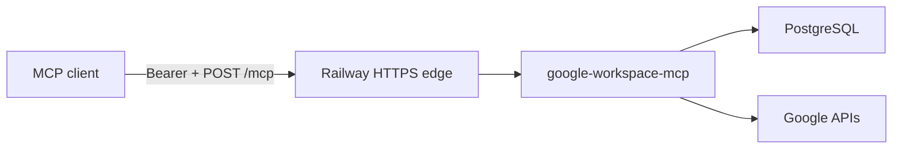

# Railway deployment plan

| | |
|---|---|
| Status | Operator plan |
| App | `google-workspace-mcp` 0.2.0 |
| Target | One Railway service, Streamable HTTP |
| Companion | [docs/deployment.md](./docs/deployment.md) |

This is the shortest path from this repository to a public `https://…/mcp` endpoint on Railway. Tool names, schemas, and error codes stay the same as the local stdio server. Railway only changes where the process runs and which environment variables it sees.

## 1. What has to be true before the process will listen

`node dist/index.js` with `TRANSPORT=http` exits before it opens a socket unless these are set. The messages come from `src/config/startup.ts`.

| Requirement | Why it matters on Railway |
|---|---|
| `HOST` left unset | The local default is `127.0.0.1`. When `RAILWAY_ENVIRONMENT` is set, an empty `HOST` becomes `::`, which accepts the IPv4 and IPv6 addresses Railway uses. |
| `PORT` left unset | Railway injects `PORT` at runtime. The process already reads it. A hardcoded `PORT` makes the health check miss the listening socket. |
| `PUBLIC_BASE_URL` | HTTPS origin clients use, no path. When it is empty, the process uses `https://` plus `RAILWAY_PUBLIC_DOMAIN`. |
| `GOOGLE_REDIRECT_URI` | When it is empty on Railway, the process uses `PUBLIC_BASE_URL` + `/oauth/google/callback`. The Google Web client must list that exact URI. |
| `TOKEN_ENCRYPTION_KEY` | 32 bytes, base64. Refresh tokens are stored as ciphertext. The same key must survive every redeploy. |
| A token store that survives the container disk | Railway’s filesystem is wiped on each deploy. An empty `TOKEN_STORE` becomes `postgres` when `TOKEN_STORE_DATABASE_URL` or `DATABASE_URL` is set. |
| Caller auth | Production requires `MCP_AUTHORIZATION_SERVER` and refuses `MCP_DEV_BEARER_SHA256`. A first deploy can use the development bearer instead. See section 5. |

`npm start` runs `node dist/index.js`. Railpack detects Node from `package.json`, installs dependencies, runs `npm run build` (`tsc` plus schema copy), then starts that script. `engines.node` is `>=22`, which Railpack resolves as Node 22. No Dockerfile is required.

An empty `TRANSPORT` becomes `http` on Railway. Local runs stay on `stdio` because `RAILWAY_ENVIRONMENT` is absent. Any variable you set explicitly overrides these defaults.



Keep the service at one replica. The rate limiter and access-token cache are in memory. Idempotency and OAuth state live in PostgreSQL, so a later second replica can share the database, but one replica is the right first deploy.

## 2. Create the Railway project

1. Push this repository to GitHub. Do not commit `.env`, `data/`, or any `*.sqlite` file. Those paths are already in `.gitignore`.
2. In [Railway](https://railway.com), create a project and deploy this repo as a service. Leave the builder on Railpack.
3. Add a PostgreSQL database in the same project. Wait until it is running.
4. On the app service, open **Networking** and generate a public domain. Copy the origin, for example `https://google-workspace-mcp-production.up.railway.app`. No trailing slash.
5. Apply the project file so the app service, Postgres, and `/readyz` health check exist together:

```bash
railway login
railway link
railway config apply
```

`.railway/railway.ts` is the file Railway reads for a new project. It starts `npm start`, checks `/readyz`, keeps one replica, and sets `TOKEN_STORE_DATABASE_URL` from the private Postgres URL. `railway.toml` is not used: new Railway services ignore it. `/readyz` returns 200 only after the token store answers. `/healthz` only proves the process is up.

Secrets in that file are `preserve()`, so apply keeps values you set in the dashboard and does not write them into git. Set `TOKEN_ENCRYPTION_KEY`, the Google client, and either `MCP_DEV_BEARER_SHA256` or `MCP_AUTHORIZATION_SERVER` in the service variables before the health check can pass.

## 3. Variables

Set these secrets on the **app** service. The process reads `TOKEN_STORE_DATABASE_URL`, and on Railway it uses `DATABASE_URL` when that variable is empty.

| Variable | Value |
|---|---|
| `GOOGLE_OAUTH_CLIENT_ID` | Web client id from section 4 |
| `GOOGLE_OAUTH_CLIENT_SECRET` | Web client secret |
| `TOKEN_ENCRYPTION_KEY` | output of the command below |
| `NODE_ENV` | `development` for the first deploy. See section 5 before switching this to `production`. |
| `MCP_DEV_BEARER_SHA256` | hex SHA-256 of the bearer you will send. See section 5. |

Leave `TRANSPORT`, `HOST`, `PORT`, `TOKEN_STORE`, `LOG_CONTENT`, and `METRICS_ENABLED` unset when you apply `.railway/railway.ts`. That file sets the non-secret ones. Leave `PUBLIC_BASE_URL` and `GOOGLE_REDIRECT_URI` unset unless the public origin is a custom domain; the process fills both from `RAILWAY_PUBLIC_DOMAIN` after you generate a domain.

`TOKEN_STORE_DATABASE_URL` is `${{Postgres.DATABASE_URL}}` inside `.railway/railway.ts`. That reference is the private `*.railway.internal` URL. If the database service has another name, change the `postgres("Postgres")` call to match it. The process also accepts a `DATABASE_URL` value when `TOKEN_STORE_DATABASE_URL` is empty. `src/auth/pg-db.ts` passes the connection string to `pg` as-is.

Generate the encryption key locally and paste it into Railway. Do not commit it.

```bash
node -e "console.log(require('crypto').randomBytes(32).toString('base64'))"
```

Leave `PORT` unset. Leave `ALLOW_SINGLE_REPLICA_SQLITE` unset. Leave `TOKEN_ENCRYPTION_KEY_REF` unset; this build does not resolve a secret-manager reference.

Changing `TOKEN_ENCRYPTION_KEY` after accounts exist makes stored refresh tokens unreadable. Treat a key rotation as a new authorization for every Google account.

Tables are created on startup (`CREATE TABLE IF NOT EXISTS` in `PostgresTokenStore`). There is no separate migration step.

Redeploy after the variables are saved. The first deploy, before `PUBLIC_BASE_URL` exists, is expected to exit. The logs will name the missing variable.

## 4. Google OAuth client

The hosted callback is a public HTTPS URL, so the Google client type is **Web application**. The Desktop client used for local `google-workspace-mcp auth` cannot serve this redirect.

1. In Google Cloud Console, open the same project you use for local development, or create one.
2. Enable the Gmail API and the Google Docs API.
3. Configure the OAuth consent screen. For a quick personal deploy, External plus test users is enough. Add the Google account that will send mail and edit the Doc as a test user while the app is in testing.
4. Create an OAuth client of type **Web application**.
5. Authorized redirect URI: the exact `GOOGLE_REDIRECT_URI` from section 3.
6. Copy the client id and secret into the Railway variables.

Scopes the consent screen needs:

- `openid`
- `email`
- `profile`
- `https://www.googleapis.com/auth/gmail.send`
- `https://www.googleapis.com/auth/documents`

`gmail.send` can send mail and cannot read the mailbox. The Docs scope can read and edit documents the account can open. That is the same scope the local server uses. See [SECURITY.md](./SECURITY.md).

## 5. How the MCP client authenticates

This process does not issue MCP access tokens. It only validates them.

### First deploy: one shared bearer

Use this to get a client connected the same day. `NODE_ENV` must not be `production`.

Generate a bearer and its hash locally:

```bash
node -e "const c=require('crypto'); const b=c.randomBytes(32).toString('base64url'); console.log(b); console.log(c.createHash('sha256').update(b).digest('hex'))"
```

Put the hex line in `MCP_DEV_BEARER_SHA256`. Keep the first line as the bearer the client sends. To pin the principal, use `sha256|tenantId|userId` instead of the bare hash. With a bare hash, the principal falls back to `TENANT_ID` and `USER_ID` (both default to `local`).

Anyone who has the bearer and the public URL can call the tools as that principal. Use a long random bearer, store it in a password manager, and do not put it in the repository.

### Production: an external issuer

When you are ready to refuse shared secrets:

| Variable | Value |
|---|---|
| `NODE_ENV` | `production` |
| `MCP_AUTHORIZATION_SERVER` | HTTPS issuer URL |
| `MCP_RESOURCE_AUDIENCE` | Exact `aud` on the issuer’s tokens. Omit it to use `PUBLIC_BASE_URL`. |
| `MCP_DEV_BEARER_SHA256` | Delete the variable. Production startup exits if it is set. |

Tokens must have `iss` equal to that issuer, `aud` equal to the resource audience, a `sub` (this becomes `user_id`), an expiry, and `scope` or `scp` containing `tools.call`. An optional `tenant_id` claim selects the tenant. If it is absent, the server uses `DEFAULT_TENANT_ID`, then `TENANT_ID`.

`tools.call` is the MCP caller scope. It is unrelated to `gmail.send` and `documents`.

Unauthenticated calls to `/mcp` return `401` and `WWW-Authenticate` pointing at `/.well-known/oauth-protected-resource`.

## 6. Connect a client

After `/readyz` returns 200, point the client at the MCP path.

Development bearer, for a client that can send a static header (Cursor’s project MCP config can):

```json
{
  "mcpServers": {
    "google-workspace": {
      "url": "https://<your-railway-domain>/mcp",
      "headers": {
        "Authorization": "Bearer <the bearer from section 5>"
      }
    }
  }
}
```

Production, after an issuer is configured: the same URL with no static header. The client runs the MCP OAuth flow against `MCP_AUTHORIZATION_SERVER`. The server advertises that issuer from the protected-resource metadata.

Google authorization is a second step, after the client can call tools. Call `google_begin_authorization`. Open the returned `authorization_url` in a browser. Google redirects to `/oauth/google/callback`. The HTML page shows the account email and does not include tokens. Then call `gmail_send_email` or `gdocs_append_content` with the same arguments you use locally.

## 7. Check the deploy

Run these from your machine. Replace the origin and the bearer.

```bash
curl -sS "https://<your-railway-domain>/healthz"
curl -sS "https://<your-railway-domain>/readyz"
curl -sS -D - -o /dev/null -X POST "https://<your-railway-domain>/mcp"
```

Expected:

| Check | Result |
|---|---|
| `/healthz` | `200` and `{"status":"ok"}` |
| `/readyz` | `200` and `{"status":"ok"}` |
| `POST /mcp` with no bearer | `401` and a `WWW-Authenticate` header |
| Railway deploy log | One stderr line, `http listening`, with the injected port |
| `tools/list` with the bearer | Five tools, same names as stdio |

Then, from the MCP client: begin Google authorization, send one plain-text message, append once to a Doc you can edit, and repeat the same `idempotency_key`. The second call returns the stored result and does not send or append again.

Deploy logs are the process stderr. With `LOG_CONTENT=false` they omit message bodies and document text. Do not turn on a request log that records the query string of `/oauth/google/callback`; that query contains the Google authorization code.

## 8. Failures you will see in the deploy log

| Log message | Fix |
|---|---|
| `PUBLIC_BASE_URL is required` | Set the Railway HTTPS origin. `http://` is accepted by the parser; use `https://` so Google’s redirect matches. |
| `GOOGLE_REDIRECT_URI is required` | Set the callback URL. |
| `MCP_AUTHORIZATION_SERVER is required when NODE_ENV=production` | Set an issuer, or use `NODE_ENV=development` and a dev bearer for the first deploy. |
| `MCP_DEV_BEARER_SHA256 is refused when NODE_ENV=production` | Remove the dev bearer before setting production. |
| `TOKEN_STORE_DATABASE_URL is required` | Set `${{Postgres.DATABASE_URL}}`. |
| `TOKEN_ENCRYPTION_KEY is required` | Set the 32-byte base64 key. |
| Health check failed, app listening | `HOST` is `127.0.0.1`, or `PORT` was overridden. Leave both unset on Railway. |
| `/readyz` returns 503 | The app cannot reach PostgreSQL. Confirm the private URL reference and that both services are in the same project and environment. |
| Google redirect mismatch | The authorized redirect URI and `GOOGLE_REDIRECT_URI` differ by scheme, host, or path. |

## 9. After it is up

- Scaling past one replica is safe for idempotency only while every replica shares this PostgreSQL database and this `TOKEN_ENCRYPTION_KEY`. Add replicas only after caller auth is the production issuer.
- A redeploy keeps Google accounts, idempotency rows, and audit rows because they are in PostgreSQL. It drops the in-memory access-token cache, which is rebuilt from refresh tokens.
- SQLite on a Railway volume is a possible single-process alternative (`TOKEN_STORE=sqlite`, `ALLOW_SINGLE_REPLICA_SQLITE=true`, volume mounted at the SQLite path). PostgreSQL is the path this plan uses, because a volume is still one replica and is wiped if the volume is detached.
- Custom domains are optional. If you add one, update `PUBLIC_BASE_URL`, `GOOGLE_REDIRECT_URI`, and the Google client’s redirect list together, then redeploy.
