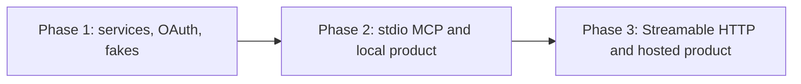

# Implementation Plan: Gmail and Google Docs MCP Server

| | |
|---|---|
| Status | v1 build plan |
| Sources | [problemStatement.md](./problemStatement.md), [architecture.md](./architecture.md) |
| Phases | 3 |
| Date | 2026-10-10 |

This plan turns the architecture into three shippable increments. Each phase has a demo, a test gate, and a written exit. The tool names, JSON Schemas, result envelope, and error codes are fixed in Phase 1 and stay stable through Phase 3.

Three phases are enough. The architecture's seven build steps collapse cleanly along two real boundaries: the line where a service becomes an MCP server, and the line where that server grows a second transport. A fourth phase would only split work that shares the same exit test.

## 1. Phase map

| Phase | Name | Architecture steps | User-visible result |
|---|---|---|---|
| 1 | Write path | 1–4 | A library and CLI that authorize a Google account, send mail, and append to a Doc, tested against fakes |
| 2 | Local MCP product | 5–6 | The same operations as MCP tools over stdio, from two clients, with audit, idempotency, and local docs |
| 3 | Hosted HTTP | 7 | The same tools over Streamable HTTP, with multi-user isolation, PostgreSQL, and deployment docs |

Phase 2 is the problem statement's definition of done for a person using the server. Phase 3 completes the deliverable list: hosted HTTP deployment, a second transport in the compatibility matrix, and tenant isolation for more than one caller.

### 1.1 Why this cut

| Boundary | What is true on the left | What waits on the right |
|---|---|---|
| End of Phase 1 | MIME, Docs indexes, OAuth, idempotency, and error translation are proven without an MCP client | No agent can discover tools yet |
| End of Phase 2 | Cursor and a second MCP client send mail and append to a Doc through published tools | One OS user per process; HTTP is refused at startup |
| End of Phase 3 | A remote client uses the same schemas over HTTPS, and one user cannot see another's accounts | Further Google capabilities (read, create, attachments) stay future work |

Policy, audit, and redaction ship in Phase 2, not later. The definition of done requires every write to be auditable and free of credential leakage before the server is called done. Metrics are recorded in Phase 2 as structured log counters. The Prometheus `/metrics` route ships in Phase 3 with the HTTP server.

### 1.2 Requirement coverage

| Problem-statement requirement | Phase |
|---|---|
| MCP tool discovery, stable names, JSON Schemas, side-effect annotations | 1 authors schemas; 2 publishes them on `tools/list` |
| `gmail_send_email` validation, MIME, BCC hiding, delivery warning, threading of our own messages | 1 |
| `gdocs_append_content` URL parsing, end-index append, revision retry, no overwrite | 1 |
| Idempotency keys, conflict on changed body, no duplicate send after an ambiguous failure | 1 |
| Account tools and OAuth with PKCE, encrypted refresh tokens, incremental scopes | 1 |
| Common result envelope and stable error codes | 1 |
| stdio transport, client-neutral tool calls | 2 |
| Two MCP clients, manual acceptance, README, `.env.example`, security notes, changelog, test instructions | 2 |
| Allowlists, rate limits, redaction, audit retention | 2 |
| Security tests: token leakage, header injection, bad document URLs, cross-account ids | 1 for pure functions and the store; 2 over stdio; 3 over HTTP |
| Streamable HTTP, hosted OAuth callback, multi-user isolation, PostgreSQL | 3 |
| Compatibility matrix and hosted deployment guide | 3 |
| Health and readiness appropriate to the transport | 2 uses MCP `ping`; 3 adds `/healthz` and `/readyz` |

Inbox read, Docs create/delete/share, attachment sending, and a combined send-and-append tool stay out of all three phases, matching the non-goals.

## 2. Cross-phase rules

These hold from the first commit of Phase 1.

1. **Contracts live in JSON Schema.** `src/tools/schemas/` is the source. A test fails if a published copy under `schemas/` differs. Zod parsers are generated or hand-written to match those files, and a test feeds each schema's examples through the parser.
2. **Services return the envelope.** MCP content blocks are created only in `src/mcp/result.ts`, which does not exist until Phase 2. Phase 1 tests assert on the envelope object.
3. **Google HTTP is injected.** `GmailClient`, `DocsClient`, and the OAuth token endpoint accept a `fetch` implementation. Unit and integration tests pass with the network disabled.
4. **Logs go to stderr.** The logger is wired in Phase 1 so Phase 2 cannot accidentally write a log line to stdout.
5. **`TRANSPORT=http` fails closed until Phase 3.** The config parser accepts the variable in Phase 1. Starting the process with `http` before Phase 3 exits with a clear message and a non-zero status.
6. **Unknown tool fields are rejected.** That policy is part of the Phase 1 parsers and is not relaxed later.
7. **No secrets in the tree.** `.env.example` contains names and comments only. Tests generate encryption keys in memory.

Suggested repository layout at the end of Phase 3 is the tree in architecture section 5.3. Earlier phases create only the directories they fill.

## 3. Phase 1 — Write path

### 3.1 Goal

A developer can run the test suite, with no MCP client and no live Google account, and see a correct send, a correct append, a correct OAuth consent exchange, and a correct idempotency decision. A developer with a test Google account can run the CLI to authorize, send one message, and append to one Doc.

### 3.2 Deliverables

- Node 22 + TypeScript project (`package.json`, `tsconfig.json`, Vitest, lockfile).
- Config loader for every variable in architecture section 12. HTTP-only variables are parsed and stored. The process entry used in this phase is the CLI, not an MCP server.
- Domain envelope, error codes, and `operation_id` generator (`op_` + ULID).
- JSON Schemas for all five tools' inputs and for the shared envelope plus per-tool `result` objects.
- Address parser, document-id parser, MIME builder, HTML sanitizer, Docs index calculator.
- `TokenCipher` (AES-256-GCM), SQLite `TokenStore`, in-memory access-token cache.
- `OAuthFlow` with PKCE, loopback callback, and `google-workspace-mcp auth`.
- `AccountService` behaviors used by the three account tools: list, status, begin. Invoked from the CLI and from tests, not from MCP yet.
- `IdempotencyService` and the state machine in architecture section 8.
- `EmailService` and `DocsService`, including check order steps 1–3 and 6–9 from architecture section 10.2. Allowlists and rate limits are stubbed as "allow" interfaces so Phase 2 can replace the implementations without changing call sites.
- `GmailClient`, `DocsClient`, and `translateGoogleError`.
- Redactor used by the logger. Audit writer interface with an in-memory implementation that tests can assert on. The SQLite audit table and retention job land in Phase 2.
- `.env.example` covering the Phase 1 variables (Google client, token store, encryption key, limits). Phase 2 completes the file.
- Unit and integration tests listed below.

### 3.3 Work sequence

Do these in order. Each item is mergeable once its tests pass.

1. **Project skeleton and config.** Strict TypeScript, Vitest, stderr logger, env parser that fails closed on a missing `TOKEN_ENCRYPTION_KEY` when a command needs the store. Package name `google-workspace-mcp`.
2. **Envelope and errors.** Types and constructors for every code in architecture section 7.1. `retryable` is required. `retry_after_seconds` is set for `RATE_LIMITED` and for an in-flight idempotency lease.
3. **Schemas and parsers.** One schema file per tool, `additionalProperties: false`. Address grammar, recipient limits, subject controls, body byte limits, attachment-field rejection, `format: plain_text` only, document URL rules.
4. **MIME and Docs index.** Plain and HTML messages, server-owned headers, BCC present in the raw MIME and absent from the structure returned to callers. Sanitizer sets `HTML_SANITIZED` when it changes the body. Index math uses UTF-16 length, skips a leading newline on an empty doc, and prefixes a newline when `prepend_newline` is true on a non-empty doc.
5. **Cipher and SQLite accounts.** Encrypt refresh tokens. Account rows are keyed by `(tenant_id, user_id, google_sub)`. Lookup by `account_id` without the matching principal returns not-found. Access tokens stay in the memory cache.
6. **OAuth flow against a fake token endpoint.** State is single-use, expires, and is bound to the principal. Success stores ciphertext and display email. `access_denied` stores nothing. `invalid_grant` on refresh marks `reauthorization_required` and deletes the ciphertext.
7. **Idempotency store.** Transitions: first reserve, replay, hash conflict, unexpired lease, expired lease to `unknown`, definitive `failed` allows a same-hash retry. Email timeout while waiting for `messages.send` becomes `unknown` and a second attempt does not call the client.
8. **Write services with fake Google HTTP.** Email: scope check, MIME, `users.messages.send`, store `(message_id, thread_id)`, warning `DELIVERY_NOT_GUARANTEED`. Reply threading resolves only ids this principal has sent. Docs: field-masked get, one `insertText`, `requiredRevisionId`, up to three revision retries inside one reservation. Error translator covers architecture section 7.2.
9. **CLI.** `auth`, `accounts`, `send` (dev-only, reads a JSON file), `append` (dev-only). The dev commands exist so a human can hit a real Google API before MCP exists. They call the same services the tools will call. They are documented as operator commands, not as a second public API.

### 3.4 Test gate

All of these run with the network disabled:

| Area | Cases |
|---|---|
| Schema | Unknown field, empty `to`, attachments present including `[]`, bad `format`, oversized body |
| Addresses | Display names, CR/LF in subject, recipient cap, domain case folding |
| MIME | Plain and HTML bytes, no caller-supplied headers, BCC only inside `raw` |
| HTML | Script and `javascript:` URL removed, warning recorded, hash stable across a retry |
| Document ids | Raw id, valid Docs URL, `http://`, wrong host, userinfo |
| Indexes | Empty doc, non-empty doc, `prepend_newline`, emoji (UTF-16 length 2) |
| Redaction | Known token, client secret, BCC, and body absent from a log line when `LOG_CONTENT=false` |
| OAuth | Success, denied consent, expired state, reused state, state from another principal, `invalid_grant`, missing `gmail.send` scope |
| Idempotency | Replay returns the stored envelope and does not call Google; different hash is `IDEMPOTENCY_CONFLICT`; expired lease is `unknown` and does not call Google |
| Gmail mock | Success ids, 401, 429 with `retry_after_seconds`, timeout becomes `unknown` |
| Docs mock | Conditional write, one conflict then success as a single operation, exhausted conflicts return `CONFLICT` |
| Isolation | Principal B's `account_id` is `ACCOUNT_NOT_FOUND` for principal A |

### 3.5 Exit criteria

- `npm test` passes offline.
- A manual smoke against a test Google account, recorded in the phase notes: CLI `auth`, one plain-text send, one append, stderr contains no refresh token or access token.
- Service interfaces that Phase 2 will wrap are stable: `EmailService.send`, `DocsService.append`, `AccountService` list/status/begin, each taking `InvocationContext` and returning the envelope.
- `TRANSPORT=http` exits before any listen socket.

### 3.6 Ships later

MCP `tools/list` and `tools/call`, stdio framing, allowlist enforcement, rate limits, SQLite audit retention, README quick start, and every HTTP route.

## 4. Phase 2 — Local MCP product

### 4.1 Goal

A person follows the README, authorizes one Google account, and connects the same server build to Cursor and one conversational MCP client. Both clients see the same five tools. Sends and appends from those clients match the Phase 1 behavior: validated, idempotent, audited, and free of credentials in the transcript and the log.

This phase meets the problem statement's definition of done.

### 4.2 Deliverables

- `src/mcp`: server registration, stdio transport, result mapper.
- Five tools registered in the architecture's fixed order, with the annotations in architecture section 6.
- `inputSchema` and `outputSchema` taken from the Phase 1 schema files.
- Tool results: `structuredContent` is the envelope, `content[0].text` is the same JSON, `isError` is true when `ok` is false. Unknown tool names are JSON-RPC errors. Invalid arguments are tool execution errors.
- `capabilities.tools.listChanged: false`. No `x-mcp-header` annotations.
- `EnvAllowlistPolicy` and in-process rate limiter and concurrency cap, wired into check-order steps 4 and 5.
- SQLite `audit_events`, retention delete, and the audit field list in architecture section 10.4.
- Metric counters emitted as structured log events (`METRICS_ENABLED` remains false and there is no scrape port).
- Contract harness that spawns the built process over stdio.
- Security tests over that process.
- Operator docs:
  - `README.md` — quick start, supported clients, local setup, configuration, OAuth (Desktop client and loopback), examples for both write tools.
  - `SECURITY.md` — scopes and the Docs over-grant, token storage, consent boundary, logging, single-user stdio isolation.
  - `.env.example` — every variable from architecture section 12, HTTP ones commented as Phase 3.
  - `CHANGELOG.md` — `0.1.0` listing the five tool names and the envelope. No breaking-change section yet.
  - `schemas/` — published copy of the tool schemas.
- Test instructions in the README (`npm test`, what the contract harness needs).

The recommended local bootstrap remains `google-workspace-mcp auth`. `google_begin_authorization` is also registered so an agent can start the same flow and receive `authorization_url`.

### 4.3 Work sequence

1. **Result mapper.** One function from envelope to MCP tool result. Contract tests can call it before the process spawn exists.
2. **Tool registry.** Names, descriptions (side effect in the first sentence, delivery warning on email, no body read-back on Docs), annotations, schema attachment. Descriptions do not override host safety policy and do not embed secrets.
3. **stdio server.** Entry `dist/index.js` with `TRANSPORT=stdio`. Logger is stderr-only before any other import writes. MCP `ping` answers. A stdout scan in tests fails if a line is not a JSON-RPC message.
4. **Wire services.** Each `tools/call` builds `InvocationContext` from `TENANT_ID` and `USER_ID` (defaults `local` / `local`). Handlers in `src/tools` only forward to the Phase 1 services.
5. **Policy and limits.** Domain, account, and document allowlists. Miss is `ACCESS_DENIED`. Rate limit and concurrency return `RATE_LIMITED` with `retry_after_seconds`. Default implementations used in Phase 1 become these real ones.
6. **Audit.** Write one row per attempt, including replays. Redaction rules from Phase 1 apply to the row. Retention job deletes rows older than `AUDIT_RETENTION_DAYS`. Idempotency rows expire on `IDEMPOTENCY_TTL_HOURS`.
7. **Contract and security harness.** Spawn the binary. Cases in section 4.4.
8. **Docs and the manual script.** README plus a `docs/manual-acceptance.md` checklist copied from architecture section 16.5, scoped to stdio and two clients.

### 4.4 Test gate

Keep the Phase 1 suite green. Add:

| Area | Cases |
|---|---|
| `tools/list` | Five names, fixed order, annotations match the architecture table, schemas match `schemas/` |
| Happy path | Fake Gmail and fake Docs behind the real stdio process; envelopes validate against `outputSchema` |
| Protocol errors | Unknown tool is JSON-RPC `-32602`; bad email is `isError: true` and `INVALID_ARGUMENT` |
| stdout purity | Captured stdout parses as JSON-RPC only |
| Allowlists | Disallowed domain and disallowed document id stop before the fake Google client is called |
| Rate limit | Burst over `RATE_LIMIT_PER_ACCOUNT_PER_MINUTE` returns `RATE_LIMITED` |
| Audit | A send writes a row with counts, no BCC, no body when `LOG_CONTENT=false` |
| Leakage | Log capture plus tool result from a fixture contain none of a planted refresh token, access token, or client secret |
| Header injection | CR/LF subject does not create an extra MIME header (re-check through the tool, not only the unit test) |
| Cross-account | Two stdio processes with different `USER_ID` values sharing a store: each list omits the other account; a foreign `account_id` is `ACCOUNT_NOT_FOUND` |
| Idempotency over MCP | Same key and body replays; same key and different body returns `IDEMPOTENCY_CONFLICT` |

### 4.5 Manual acceptance

Run architecture section 16.5 items 1–9 with a test Google account, from Cursor and from one conversational MCP client, same build, `TRANSPORT=stdio`. Record client names and versions in `COMPATIBILITY.md` with only the stdio rows filled. The HTTP row stays blank until Phase 3.

### 4.6 Exit criteria

- Automated gates in sections 3.4 and 4.4 pass.
- Both clients discover the same tool names and schemas.
- Plain-text send, HTML send, and Docs append match the manual checklist.
- Same idempotency key does not duplicate the email or the Doc text.
- Revoked Google permission returns `UNAUTHENTICATED` or `INSUFFICIENT_SCOPE` with a reauthorization `next_action`.
- An unshared Doc returns `ACCESS_DENIED` or `NOT_FOUND` without document body text.
- Transcript and stderr from the acceptance run show no OAuth credential.
- README is sufficient for a new machine to reach that run using `.env.example` and a Desktop OAuth client.

### 4.7 Ships later

Streamable HTTP, MCP protected-resource auth, public OAuth callback, PostgreSQL store, `/healthz`, `/readyz`, `/metrics`, and the hosted deployment guide.

## 5. Phase 3 — Hosted HTTP

### 5.1 Goal

The Phase 2 binary, with `TRANSPORT=http`, serves the same five tools over Streamable HTTP. Two caller principals cannot see or use each other's Google accounts. Tool semantics, schemas, and error codes match Phase 2. A deployment guide is enough for an operator to run one HTTPS instance against PostgreSQL.

### 5.2 Deliverables

- `src/mcp/http.ts`: Streamable HTTP on `POST /mcp` for protocol `2026-07-28`, including the `MCP-Protocol-Version` header check the binding requires.
- `GET /healthz` and `GET /readyz` with the fixed JSON from architecture section 13.3. Readiness pings the token store and does not call Google.
- `GET /metrics` when `METRICS_ENABLED=true`, using the counters Phase 2 already increments. Localhost-only when no `METRICS_TOKEN` is set; otherwise require that token.
- Google callback `GET /oauth/google/callback` for the Web OAuth client. Success HTML contains the account email and no tokens.
- MCP caller auth: validate bearer access tokens against `MCP_AUTHORIZATION_SERVER` (issuer, audience, JWKS). `sub` becomes `user_id`. Tenant comes from `MCP_TENANT_CLAIM` or `DEFAULT_TENANT_ID`. Unauthenticated MCP calls get `401` and `WWW-Authenticate` pointing at protected-resource metadata.
- Development bearer: `MCP_DEV_BEARER_SHA256` works only when `NODE_ENV` is not `production`. Production startup refuses that variable.
- `PostgresTokenStore` implementing the same interface as SQLite, including OAuth state, accounts, operations, and audit.
- Startup rule: `TRANSPORT=http` and `TOKEN_STORE=sqlite` exits unless `ALLOW_SINGLE_REPLICA_SQLITE=true`.
- Contract tests against HTTP on a random port, using the dev bearer and fake Google clients.
- Security test: two bearers, one database, cross-principal list and `account_id` use.
- Docs:
  - README section for hosted mode and the remote MCP client config.
  - `docs/deployment.md` — TLS proxy, `PUBLIC_BASE_URL`, Web OAuth client, PostgreSQL, replica notes, what must not be logged at the proxy.
  - `SECURITY.md` updated with the HTTP principal source and the production bearer refusal.
  - `COMPATIBILITY.md` HTTP row filled for at least one remote client.
  - `CHANGELOG.md` entry `0.2.0` stating that tool names and schemas are unchanged and HTTP is now a supported transport.

No tool schema change is allowed in this phase. If a schema bug is found, it is a patch to the Phase 1 contract plus a changelog note, and both transports pick it up together.

### 5.3 Work sequence

1. **HTTP skeleton.** Listen, MCP endpoint, health routes, stderr logs, config required: `PUBLIC_BASE_URL`, and in production `MCP_AUTHORIZATION_SERVER`.
2. **Principal resolver.** Interface used by both transports. stdio keeps the env principal. HTTP uses the validated token. `InvocationContext.transport` is `streamable-http`.
3. **Protected-resource metadata.** Document and route required for MCP authorization-server discovery. Scope challenge on `401` lists a single server scope such as `tools.call` for invoking tools. This scope is the MCP caller scope. It is unrelated to `gmail.send` and `documents`.
4. **PostgreSQL store.** Same SQL behavior as SQLite, including the idempotency compare-and-set. Integration tests run against a local Postgres or a testcontainer. SQLite tests stay in the suite.
5. **Hosted OAuth callback.** Reuse `OAuthFlow`. State remains bound to the HTTP principal that called `google_begin_authorization`.
6. **Contract tests.** Repeat the Phase 2 discovery, fake send, fake append, unknown tool, and `INVALID_ARGUMENT` cases over HTTP. Assert byte-for-byte schema equality with the stdio `tools/list` output.
7. **Isolation test.** Two dev bearers mapped to two users. Repeat the cross-account cases.
8. **Deployment docs and one hosted manual pass.** Authorize through the HTTPS callback, send one message, append once, retry the same idempotency key, confirm the second principal's list is empty of the first principal's account.

### 5.4 Test gate

Phase 1 and Phase 2 suites stay green. Add:

| Area | Cases |
|---|---|
| Discovery parity | stdio and HTTP `tools/list` tool names, order, and schemas match |
| Envelope parity | The same fake send input returns the same envelope shape on both transports |
| Auth | Missing bearer is `401` with `WWW-Authenticate`; bad audience is `401`; production config with `MCP_DEV_BEARER_SHA256` refuses to start |
| Health | `/healthz` is 200 without account data; `/readyz` is 503 when the store is down |
| Callback | Valid state stores a ciphertext; foreign principal's state is rejected; success page source contains no token strings |
| Store | Idempotency replay and `unknown` behave the same on PostgreSQL as on SQLite |
| Startup | HTTP plus SQLite exits unless the single-replica flag is set |

### 5.5 Exit criteria

- Automated gates for all three phases pass.
- A remote MCP client completes one send and one append using the published schemas.
- Two users on one server cannot list or select each other's Google accounts.
- `docs/deployment.md` and the README hosted section match the configuration that was actually run.
- `COMPATIBILITY.md` has stdio rows for two clients and one Streamable HTTP row.
- Changelog states that `0.2.0` adds a transport and does not change tool names or schemas.

### 5.6 Project complete

After Phase 3, the deliverable list in the problem statement is covered:

| Deliverable | Where it landed |
|---|---|
| Server source | Phases 1–3 |
| README quick start, clients, local setup, configuration, OAuth, examples | Phase 2, hosted section in Phase 3 |
| JSON Schemas | Phase 1, published in Phase 2 |
| `.env.example` with no secrets | Phase 2, HTTP comments already present; Phase 3 confirms they match behavior |
| Security and privacy documentation | Phase 2, HTTP isolation added in Phase 3 |
| Test suite and run instructions | Phases 1–3, instructions in the README from Phase 2 |
| Deployment guidance for stdio and hosted HTTP | Phase 2 README for stdio; Phase 3 `docs/deployment.md` |
| Changelog | Phase 2 `0.1.0`, Phase 3 `0.2.0` |

The definition of done is already true at the end of Phase 2 for local clients. Phase 3 extends it to hosted callers without a second implementation of send or append.

## 6. Version and review points

| Tag | Moment | What a reviewer checks |
|---|---|---|
| `0.1.0-core` | End of Phase 1 | Tests offline; CLI smoke notes; services return envelopes; no MCP dependency required to test a write |
| `0.1.0` | End of Phase 2 | Two-client manual checklist; stdout purity; audit row from a real send; SECURITY.md matches the scopes in code |
| `0.2.0` | End of Phase 3 | Schema parity across transports; production startup refuses the dev bearer; deployment doc matches the run |

Review at the phase boundary, not at every architecture step. Inside a phase, land the work sequence as small pull requests that keep `npm test` green.

## 7. Risks to watch at the boundaries

| Risk | When it shows up | What to do inside the phase |
|---|---|---|
| Gmail `raw` MIME rejected | Phase 1 manual smoke | Fix the builder against the real API before wrapping it in MCP |
| Docs index off by one, or a leading newline on an empty doc | Phase 1 manual smoke | Adjust the calculator; the unit table is the regression lock |
| Desktop OAuth client rejects the loopback port | Phase 1 CLI | Honor `OAUTH_LOOPBACK_PORT` and document the fixed-port case in Phase 2 README |
| A client ignores `structuredContent` | Phase 2 first client | The text content item is the supported path; do not add a client-specific wrapper |
| stdio client breaks because a dependency logs to stdout | Phase 2 contract harness | Keep the stdout purity test in the default `npm test` run |
| HTTP auth work starts to grow an embedded authorization server | Phase 3 | Stop at resource-server validation of an external issuer, as the architecture decision log requires |
| Schema tweak during HTTP work | Phase 3 | Treat it as a contract change: update both transports, schemas, and the changelog together |

## 8. After v1

The extension points in architecture section 18 (markdown append, real attachments, Gmail read, Docs create, KMS, remote policy) are new projects. They are not a Phase 4 of this plan. Each one needs its own schema review because Phase 1 parsers reject unknown fields on purpose.
